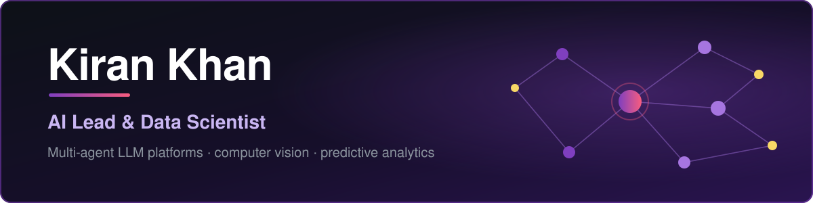
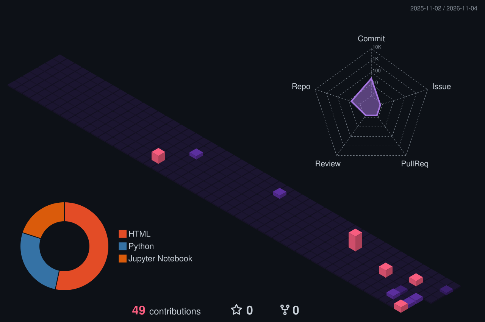

  
  

<h3 align="center">
  👋 Hi, I'm <a target="_blank" href="https://www.linkedin.com/in/kewri-khan/">Kiran Khan</a>
</h3>
<h4 align="center">
  AI Lead &amp; Data Scientist at Poulta, Inc. · MS Artificial Intelligence student at FAST-NUCES · Karachi, Pakistan (remote-first)
</h4>

  <b>I build AI systems and analytics that businesses actually run on.</b> 
  Multi-agent LLM platforms, KPI dashboards, forecasting models, and computer vision on live video, designed, built and shipped end to end, with every figure computed in code. Currently directing a team of five.

  
  
  

  
  
  
  
  

  

## 🌟 About Me

AI Lead with **5+ years of experience** leading teams in the design and deployment of multi-tenant enterprise AI platforms, predictive analytics and computer vision systems. My expertise is building role-scoped LLM agents under a unified single sign-on (SSO) and robust multi-tenant control planes. Guided by a design philosophy of high-reusability tenant architecture and deterministic, grounded generation, I consistently deliver end-to-end operational automation and production analytics across diverse business segments.

> **Build once, reuse per tenant.** I own the backend and multi-agent architecture of a multi-tenant enterprise AI platform: role-scoped LLM agents behind single sign-on, serving multiple business segments. Two principles run through it: build once and reuse per tenant, and grounded agents that never invent a figure, with every number computed in code. That means an org-tree scope guard, a control plane that provisions each company as an isolated cell, and an AI gateway whose fallback chain degrades the assistant without taking dashboards or alerting down.

- 💼 **AI Lead &amp; Data Scientist at Poulta, Inc.**, owning the backend and multi-agent architecture, directing a team of five, chairing architecture reviews, and presenting to the CEO, leadership and board.
- 🦺 **Former AI/ML Engineer at MID Construction (USA, remote)**, deploying 5+ YOLO computer vision models for real-time hazard detection on construction sites.
- 📊 **5+ years in data science, analytics and computer vision**: forecasting models, YOLO-based detection and weight estimation, and 10+ Qlik Sense dashboards built on live production data.
- 🎨 **Digital Marketing Head at ZKAAH Organics**: branding, packaging, social media, website and e-commerce.
- 📍 **Karachi, Pakistan**, remote-first.
- 🤝 **Open to AI engineering and data science roles, and to freelance work.** Send a note and I'll get back to you.

## 🎓 Education

*A computer science foundation, carried straight into analytics, machine learning and applied AI.*

| When | Qualification | Institution | Result |
|---|---|---|---|
| In progress | **MS Artificial Intelligence** | FAST-NUCES (FAST National University of Computer and Emerging Sciences), Karachi | |
| 2023 | **BS Computer Science** | Bahria University | CGPA 3.6 |
| 2018 | **Intermediate** | Punjab College | A1 Grade |

**Final-year project (BS):** an autonomous four-wheel robot avoiding obstacles in real time with a neural network trained on sensor data.

**Relevant coursework:** Object-Oriented Programming, Data Structures &amp; Algorithms, Operating Systems, Database Management Systems, Software Engineering, Computer Networks, Artificial Intelligence, Information Security and Web Development.

## 💼 Experience

*Pushing boundaries since 2019. Four roles, one thread: making data do something.*

| Role | Company | Location | Dates |
|---|---|---|---|
| **AI Lead &amp; Data Scientist** | Poulta, Inc. | Karachi, Pakistan (remote) | Aug 2024 – present |
| **AI/ML Engineer** | MID Construction | USA (remote) | Feb 2025 – Oct 2025 |
| **Digital Marketing Head** | ZKAAH Organics | Karachi, Pakistan | Jan 2025 – present |
| **Data Science · Web Developer · Graphic Design** | Freelance | Remote | Jan 2019 – Jan 2024 |

<b>AI Lead &amp; Data Scientist · Poulta, Inc.</b> · Aug 2024 – present

 

- Directed the design and delivery of the AI platform: authored the backend and multi-agent architecture, led a team of 5, chaired architecture reviews, and presented to the CEO, leadership and board.
- Designed a role-scoped multi-agent LLM layer, auto-scoped by the org tree so each agent sees only its own slice of the data, governed by a deterministic scope guard and grounded so agents narrate only real, tool-computed figures.
- Developed internal agents that automate HR, procurement and marketing workflows: routing and screening requests, drafting documents, and consolidating departmental reporting.
- Built a multi-tenant control plane that provisions each company as an isolated cell with its own database, encryption key and network, reducing tenant onboarding to a provisioning step rather than a rebuild.
- Modeled live bird weight from images using computer vision, automating a manual sampling process and improving measurement consistency across flocks.
- Devised the AI gateway with a fallback chain, so an AI incident degrades the assistant without interrupting dashboards, data or alerting.
- Implemented PII redaction, append-only audit logging, SSO with two-factor sign-in, and role-based access enforced server-side, across two availability zones.
- Forecasted farm and flock performance with predictive models and built 10+ interactive Qlik Sense dashboards translating production data (mortality, FCR, feed) into actionable insights for operations teams.
- Consolidated large datasets from multiple source systems through cloud data workflows, and used SQL for extraction, transformation and analysis with operations and management.

<b>AI/ML Engineer · MID Construction</b> · USA (remote) · Feb 2025 – Oct 2025

 

- Developed and deployed 5+ computer vision models for real-time hazard detection on construction sites using YOLO and deep learning.
- Constructed image and video processing pipelines to monitor safety compliance and detect anomalies from site surveillance data.
- Delivered AI models into working applications using FastAPI for back-end services and Streamlit for interactive dashboards and demos.
- Improved site safety by automating risk detection and alerting, reducing response time and manual monitoring effort.

<b>Digital Marketing Head · ZKAAH Organics</b> · Karachi · Jan 2025 – present

 

- Directed branding and product packaging for 7+ products, shaped social media strategy, and built and maintained the company website.
- Oversaw online sales and e-commerce operations, monitoring performance and implementing strategies that increased revenue.

<b>Data Science · Web Developer · Graphic Design · Freelance</b> · Jan 2019 – Jan 2024

 

- Completed data science and machine learning projects in Python using pandas, NumPy, scikit-learn and Matplotlib for analysis, visualization and predictive modelling.
- Designed and developed modern, responsive websites using HTML, CSS, JavaScript and modern frameworks.
- Produced graphic design work for branding and digital content, and built Digital Logic Design (DLD) projects.

## 🧭 Areas of Expertise

*Seven disciplines that overlap more every year.*

| | Area | What I do |
|:-:|---|---|
| 🤖 | **Agentic AI** | Role-scoped multi-agent LLM layers with a deterministic scope guard, and agents that narrate only real, tool-computed figures. |
| 👁️ | **Computer Vision** | YOLO and deep learning for real-time hazard detection and live weight estimation, with image and video processing pipelines behind them. |
| 📈 | **Machine Learning** | Forecasting and predictive models in Python, built to support performance analysis and proactive decisions. |
| 🔎 | **Data Analysis** | SQL and Python analysis that uncovers trends and answers ad hoc questions from operations and management. |
| 🧱 | **Data Engineering** | ETL and cloud data workflows that integrate and reconcile large datasets from SQL and MongoDB source systems without losing integrity. |
| 🔐 | **Platform Security** | PII redaction, append-only audit logging, SSO with two-factor sign-in, and role-based access enforced server-side. |
| 🌐 | **Web Development** | Responsive sites and app front ends in HTML, CSS, JavaScript and React, with FastAPI and Streamlit for serving models. |

## 🚀 Work I've Brought to Life

*A selection of AI and data science projects that show how I approach a problem end to end.*

<b>🤖 Agentic AI</b>

 

**Multi-Tenant Multi-Agent AI Platform** · *Agentic AI · architecture owner* 
Role-scoped LLM agents answer operational questions and run routine multi-step workflows across multiple business segments, behind one login and a control plane over isolated per-company cells, with grounded tools, PII redaction and full audit.
- Auto-scoped by the org tree, with a deterministic scope guard
- Architecture owner, directing a team of five
- Grounded tools: every figure computed in code
- Per-tenant database, encryption key and network
- AI gateway fallback chain: an AI incident never takes down dashboards

**Internal Automation Agents (HR, Procurement, Marketing)** · *Agentic AI · internal tooling* 
Departmental agents that automate recurring internal workflows: routing and screening requests, drafting documents, and consolidating reporting across teams.
- Request routing and screening
- Document drafting from real records
- Consolidated departmental reporting

<b>📊 Analytics &amp; Data Science</b>

 

**Poultry Intelligence Dashboards** · *Analytics &amp; dashboards* 
10+ interactive Qlik Sense dashboards translating production data (mortality, FCR, feed) into actionable insights for operations teams.
- Multi-source data reconciled into unified KPIs
- Forecasting models for proactive decisions
- Built on live production data

**Farm &amp; Flock Forecasting Models** · *Data science · forecasting* 
Predictive models over farm and flock performance data, supporting performance analysis and proactive, data-driven decision-making.
- Trained on live production data
- Python: pandas, NumPy, scikit-learn
- Feeds the dashboards operations teams use

<b>👁️ Computer Vision &amp; Deep Learning</b>

 

**Hazard Detection System** · *Computer vision* 
Real-time system using YOLO and deep learning to detect safety hazards from live construction-site video feeds and raise automated alerts, served via FastAPI and Streamlit.
- 5+ deployed detection models
- Image and video processing pipelines
- FastAPI back end, Streamlit demos
- Faster response, less manual monitoring

**Livestock Weight Estimation** · *Computer vision* 
Vision model estimating live bird weight from images, automating manual sample weighing and delivering consistent measurement across flocks.
- Replaces a manual sampling process
- Consistent measurement flock to flock
- Deployed on live production imagery

**Age Estimation System** · *Deep learning* 
Deep-learning model predicting a person's age from facial images, covering preprocessing, training and evaluation in Python.
- Full pipeline: preprocessing to evaluation
- Feature extraction on facial imagery
- Built and benchmarked in Python

<b>🛠️ Robotics, Web &amp; Desktop</b>

 

**Hurdle-Avoiding Four-Wheel Bot** · *Final-year project* 
Autonomous four-wheel robot avoiding obstacles in real time using a neural network trained on sensor data.

**E-Commerce Website** 
Full-stack online store with product catalog, cart and checkout, built with a responsive, user-focused design.

**Pharmacy Management System** 
Desktop application to manage inventory, sales and billing, backed by a relational database.

**Hospital Management System** 
Desktop application for patient records, appointments and administrative workflows, backed by a relational database.

<b>🎓 Research &amp; Coursework on GitHub</b>

 

**[Pakistan's Winters](https://github.com/KiranKhann/pakistan-winters-eof)** 
EOF analysis of climate data (Hannachi 2004) replicated on NOAA data, with a Streamlit app explaining Pakistan's winters and a crop advisor for farmers.

**[Urdu Sarcasm Detection](https://github.com/KiranKhann/urdu-sarcasm-detection)** 
Urdu sarcasm detection with emoji semantics (DS5007 NLP, Fall 2026).

## 🛰️ Latest from the Lab

<!-- LATEST:START -->
| | Project | What it is | Updated |
|:-:|:--|:--|:--|
| 🐍 | **[pakistan-winters-eof](https://github.com/KiranKhann/pakistan-winters-eof)** | EOF analysis of climate data (Hannachi 2004) replicated on NOAA data, with a Streamlit app on Pakistan's winters and a crop advisor for farmers | yesterday |
| 📓 | **[urdu-sarcasm-detection](https://github.com/KiranKhann/urdu-sarcasm-detection)** | Urdu sarcasm detection with emoji semantics (DS5007 NLP, Fall 2026, Assignment 1) | 2 weeks ago |
| 🌐 | **[Portfolio](https://github.com/KiranKhann/Portfolio)** | My Personal Portfolio | 2 months ago |
| 🌐 | **[Multi-Agent-Hierarchy](https://github.com/KiranKhann/Multi-Agent-Hierarchy)** | — | 5 months ago |

🤖 This list updates itself every day through a GitHub Action · last refresh 01 Nov 2026, 19:59 PKT
<!-- LATEST:END -->

## 🧰 The Toolkit

**Analytics &amp; BI** 

**Data &amp; Cloud** 

**Machine Learning &amp; Computer Vision** 

**Agentic AI &amp; Serving** 

**Platform &amp; Security** 

**Web &amp; Design** 

**Tools** 

## 📌 Featured Repositories

  
  
  
  

## 🧊 Contributions in 3D

  

🤖 Redrawn every day by a GitHub Action from my contribution calendar.

  
  

## 🤝 Let's Build Something Meaningful Together

  Open to <b>AI engineering and data science roles</b>, and to <b>freelance work</b>. Send a note and I'll get back to you.  
  
  
  

